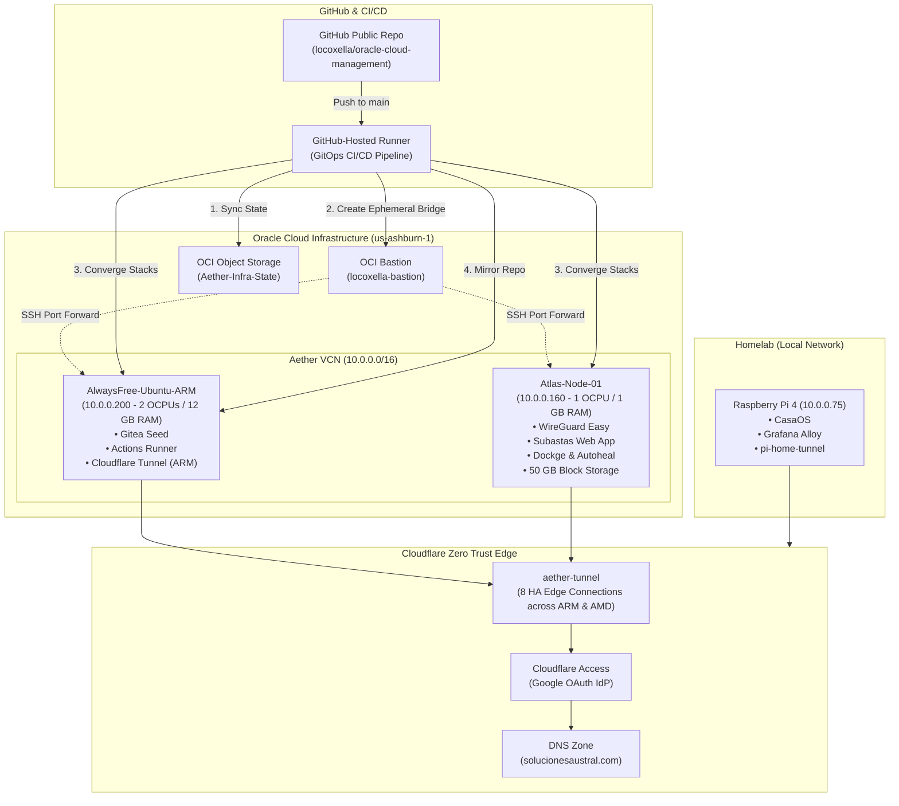

# 🌌 Oracle Cloud Infrastructure: Management & GitOps (Aether)

[](https://github.com/Locoxella/oracle-cloud-management/actions/workflows/gitops.yml)
[](https://git.solucionesaustral.com/locoxella/oracle-cloud-management/actions)
[](https://git.solucionesaustral.com/locoxella/oracle-cloud-management/actions)
[](https://git.solucionesaustral.com/locoxella/oracle-cloud-management/actions)
[](https://github.com/Locoxella/oracle-cloud-management/tags)
[](https://github.com/Locoxella/oracle-cloud-management/tags)
[](https://github.com/Locoxella/oracle-cloud-management/issues)
[](https://git.solucionesaustral.com/locoxella/oracle-cloud-management/issues)
[](https://git.solucionesaustral.com/locoxella/oracle-cloud-management)
[](https://www.cloudflare.com/zero-trust/)
[](https://opensource.org/licenses/MIT)

> [!NOTE]
> **Personal Infrastructure Showcase**: This repository contains the Infrastructure as Code (IaC), Configuration as Code (CaC), and automated GitOps CI/CD pipelines used to maintain **my personal infrastructure** across Oracle Cloud (OCI Always Free tier), Cloudflare Zero Trust Edge, and my local Homelab.
>
> I share this repository publicly as an engineering showcase and production-tested reference architecture. If you find parts of this setup useful for managing your own cloud infrastructure and homelab, joy! Feel free to fork, adapt, or borrow ideas.

---

## 🏛️ Architecture Overview

The platform (codename **Aether**) unifies public cloud compute with edge networking and homelab observability into a resilient, self-healing system:



---

## 🚀 Key Architectural Pillars

### 1. 100% GitOps with Ephemeral Bastion Bridge (Option B)

- **Zero Circular Dependencies**: Computes are provisioned and converged from external GitHub-Hosted runners rather than running a self-hosted agent on the same target virtual machine being configured.
- **Dynamic Port Forwarding**: The GitHub Actions runner dynamically requests an ephemeral port-forwarding session from the OCI Bastion service (`locoxella-bastion`), binds local random ports, and routes Ansible playbooks through SSH `ProxyCommand`.
- **Trap-Enforced Cleanup**: At the end of the playbook (or upon interruption), signal handlers cleanly tear down local SSH tunnels and destroy OCI Bastion sessions with `oci bastion session delete --force`. Zero SSH ports are left exposed to the public internet.

### 2. High Availability Cloudflare Zero Trust Ingress

- **Active-Active Tunnel (`aether-tunnel`)**: Runs concurrently across both `AlwaysFree-Ubuntu-ARM` and `Atlas-Node-01`, providing 8 active connections to the Cloudflare Edge network with automatic failover and internal subnet routing.
- **Independent Homelab Tunnel (`pi-home-tunnel`)**: Ensures direct, zero-trust remote access to homelab services (`dockge-pi.solucionesaustral.com`) even during cloud maintenance windows.
- **Identity-Aware Access**: Administrative endpoints (Dockge manager, WireGuard web dashboard) require multi-factor authentication via Google Workspace OAuth identity provider before reaching backend services.

### 3. Decoupled Cloud-Native State Management

- OpenTofu remote state (`terraform.tfstate`) is backed up and versioned in OCI Object Storage (`Aether-Infra-State` bucket, namespace `idsbz3qyzayx`).
- State files are strictly ignored from Git and synced exclusively at pipeline execution time.

### 4. Continuous Repository Mirroring (GitHub ↔ Gitea)

- **GitHub (`Locoxella/oracle-cloud-management`)**: Acts as the primary public GitOps source of truth.
- **Gitea (`git.solucionesaustral.com`)**: Operates as a centralized private backup and package registry.
- Commits pushed to GitHub are automatically mirrored to the private Gitea instance at the end of every successful CI/CD run.

---

## 🖥️ Node Topology & Specifications

| Node Name | Architecture & Shape | Resources | Network IP | Primary Workloads |
| :--- | :--- | :--- | :--- | :--- |
| **`AlwaysFree-Ubuntu-ARM`** | Ampere Altra (`VM.Standard.A1.Flex`) | 2 OCPU / 12 GB RAM / 47 GB Boot | `10.0.0.200` (Private) · `129.213.96.28` (Public) | • Gitea Forgejo (`:3000`, `:2222`) • Gitea Actions Runner • HA Cloudflare Tunnel (ARM) • Dockge ARM (`:5001`) |
| **`Atlas-Node-01`** | AMD EPYC (`VM.Standard.E2.1.Micro`) | 1 OCPU / 1 GB RAM / 47 GB Boot + 50 GB Vault | `10.0.0.160` (Private) · `129.153.185.184` (Public) | • WireGuard Easy VPN (`:51820 UDP`, `:51821`) • Subastas Web Application • Dockge AMD & Autoheal • HA Cloudflare Tunnel (AMD) |
| **`raspberry_pi`** | ARM Cortex-A72 (Raspberry Pi 4) | 4 Cores / 8 GB RAM / 240 GB SSD | `10.0.0.75` (LAN / WG) | • CasaOS Ecosystem • Grafana Alloy Telemetry • Dedicated Homelab Cloudflare Tunnel |

---

## 📁 Repository Directory Structure

```text
oracle-cloud-management/
├── .github/
│   └── workflows/
│       └── gitops.yml               # GitHub Actions GitOps workflow (Dry-Run + Owner Apply + Mirror)
├── .gitea/
│   └── workflows/
│       ├── validation.yml           # Mirror pre-flight validation workflow
│       └── sync_from_github.yml     # Scheduled pull synchronization from GitHub
├── ansible/
│   ├── ansible.cfg                  # Ansible configuration with optimized SSH pipelining
│   ├── inventory/
│   │   └── hosts.yml                # Unified multi-node inventory (OCI Cloud + Homelab Pi)
│   └── playbooks/
│       ├── site.yml                 # Declarative convergence playbook (idempotent)
│       └── verify.yml               # Read-only health assertion playbook
├── archive/
│   └── hunters/                     # Historical OCI Always Free capacity acquisition scripts
├── bootstrap/
│   ├── infrastructure/management/   # Base management Docker Compose stacks (Dockge, Autoheal)
│   └── stacks/                      # Service stacks (Git seed, Network VPN, Subastas app)
├── infrastructure/
│   ├── main.tf                      # OpenTofu infrastructure declarations (VCN, VMs, Security, Bastion)
│   ├── provider.tf                  # OCI provider configuration
│   └── variables.tf                 # Variable declarations
├── memory/                          # Technical architecture documentation, runbooks, and inventory
├── scripts/
│   ├── cf_common.py                 # Cloudflare API shared helper library
│   ├── export-cf-backup.py          # Cloudflare configuration backup exporter
│   ├── run_ansible_via_bastion.sh   # Ephemeral OCI Bastion port-forwarding orchestrator
│   ├── verify-cf-health.py          # Cloudflare tunnel & Zero Trust live health auditor
│   └── verify_infra.sh              # Unified pre-flight and empirical post-apply test suite
├── connect_vm.sh                    # Interactive CLI shortcut for Bastion SSH access
└── scp_to_vm.sh                     # CLI helper for secure SCP transfers via Bastion
```

---

## 🔐 Security & Public Repository Governance

This repository adheres to strict open-source security hygiene:

1. **Zero Secret Footprint**:
   - Tracked files are continuously audited for hardcoded credentials, API tokens, and private keys.
   - Historical commits are fully cleansed and verified by GitHub Push Protection.
2. **Owner-Gated Execution**:
   - Deployment and convergence steps in GitHub Actions are strictly conditioned:

     ```yaml
     if: github.repository_owner == 'locoxella' && (github.actor == 'locoxella' || github.triggering_actor == 'locoxella')
     ```

   - Pull requests from forks only execute read-only syntax checks and dry-run linting without access to repository secrets.
3. **Encrypted Secrets**:
   - Production secrets (`OCI_CLI_*`, `SSH_PRIVATE_KEY`, `CLOUDFLARE_API_TOKEN`) reside exclusively in encrypted GitHub Secrets.

---

## 🛠️ CLI Quickstart: Managing Remote VMs

Interactive access to any instance without dealing with manual Bastion parameters:

```bash
# Connect to AMD node (Atlas-Node-01)
./connect_vm.sh

# Connect to ARM node (AlwaysFree-Ubuntu-ARM)
./connect_vm.sh arm

# Execute remote commands directly
./connect_vm.sh "docker ps"
./connect_vm.sh arm "uptime"

# Run local dry-run verification suite
./scripts/verify_infra.sh

# Run empirical live verification suite (requires local Cloudflare token)
./scripts/verify_infra.sh --live
```

---

*Engineered with precision. Codename: Aether.*
